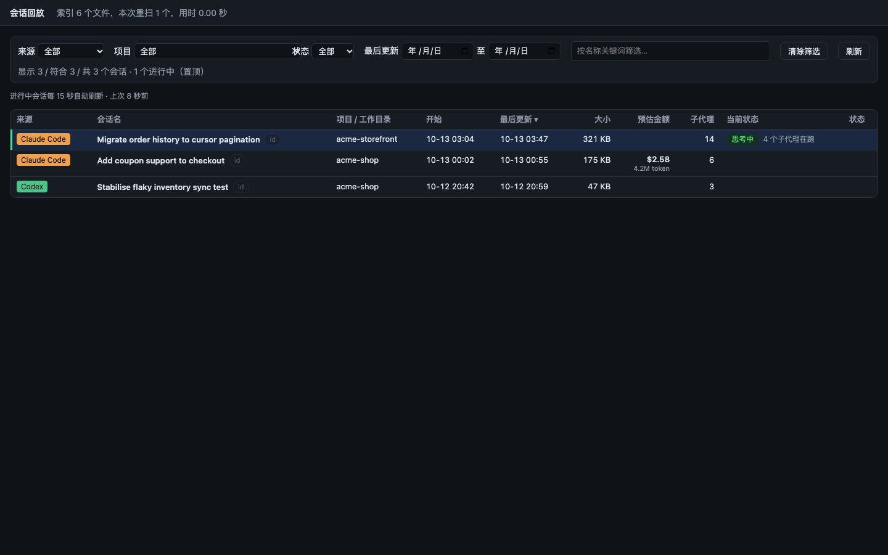
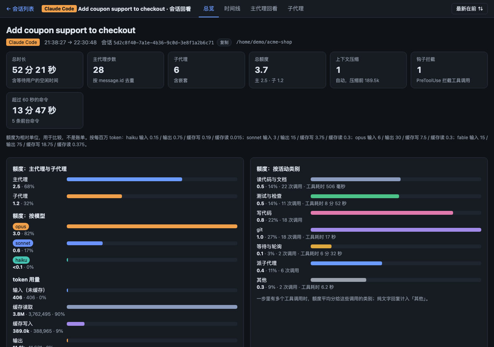
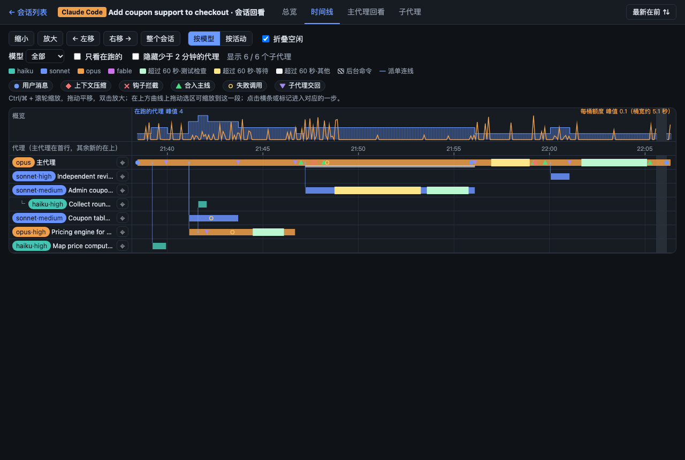
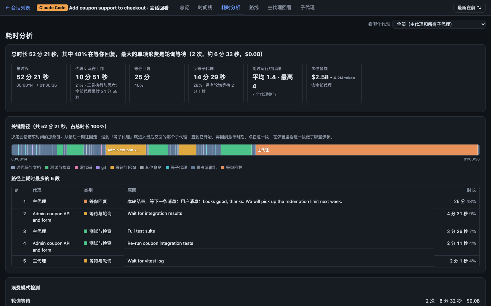
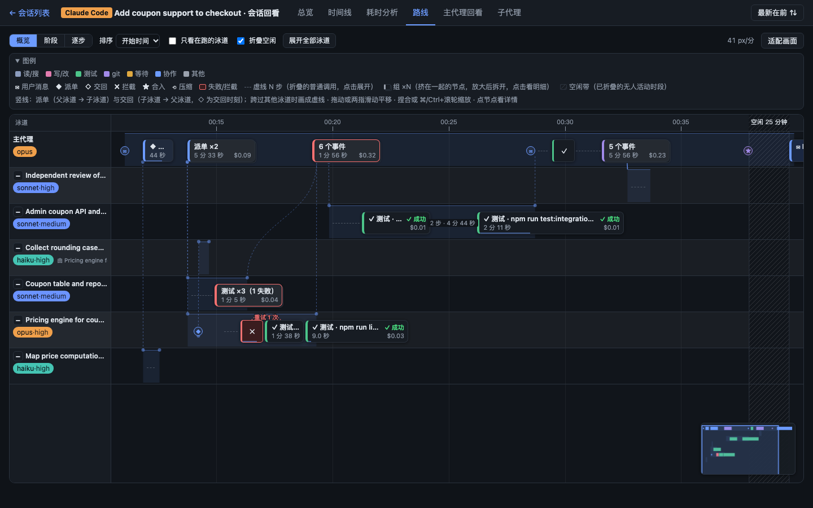
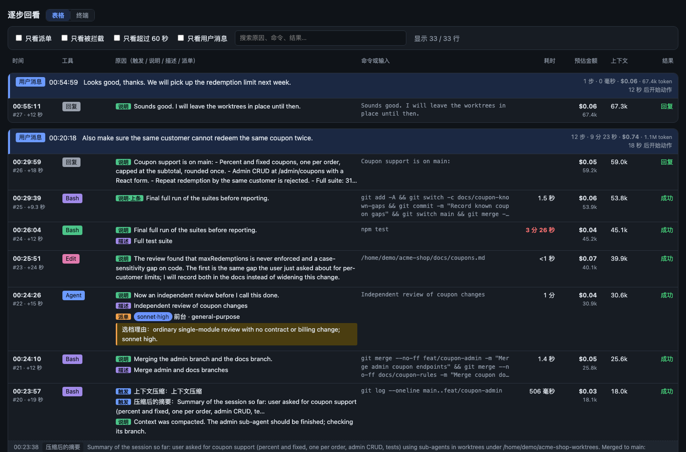
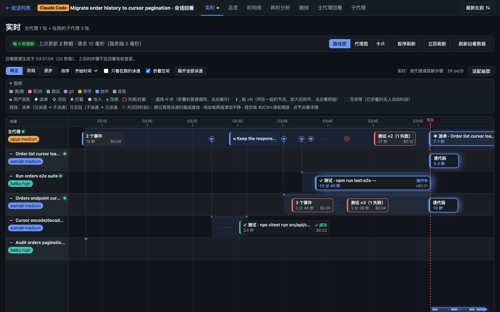

<h1 align="center">AgentReplay</h1>
<p align="center">
  <strong>看清每个代理做了什么、为什么这么做、花了多少。</strong><br />
  在本机只读查看 Claude Code、Codex、Gemini CLI、opencode 与 Cursor 会话的回放工具。把长时间运行的多代理会话整理成总览、时间线、带调用原因的逐步回看、子代理详情，以及进行中会话的实时监控。无需安装依赖，数据不出本机。
</p>
<p align="center">
  <a href="LICENSE"></a>
  <a href="#环境要求"></a>
  <a href="#环境要求"></a>
  <a href="https://github.com/Norixor/AgentReplay/stargazers"></a>
</p>
<p align="center">
  <a href="#快速开始">快速开始</a> ·
  <a href="#界面预览">界面预览</a> ·
  <a href="#配置">配置</a> ·
  <a href="https://github.com/Norixor/AgentReplay/issues">反馈</a>
</p>
<p align="center">简体中文 · <a href="README.en.md">English</a></p>

## 目录

- [关于](#关于)
- [环境要求](#环境要求)
- [快速开始](#快速开始)
- [特性](#特性)
- [界面预览](#界面预览)
- [支持的数据来源](#支持的数据来源)
- [隐私与安全](#隐私与安全)
- [配置](#配置)
- [命令行参考](#命令行参考)
- [「原因」是怎么还原的](#原因是怎么还原的)
- [项目结构](#项目结构)
- [开发](#开发)
- [已知局限](#已知局限)
- [故障排查](#故障排查)
- [许可证](#许可证)

## 关于

一个跑上几个小时、带着不同模型和强度的子代理的编程代理，留下的会话记录很难读：成千上万行、层层嵌套的代理、工具输出、重试、钩子拦截、上下文压缩。出现“慢”或“贵”的时候，问题总是那几个：每个代理做了什么？为什么发起这个调用？等了多久？大概花了多少钱（估算）？

AgentReplay 直接从 Claude Code、Codex、Gemini CLI、opencode 和 Cursor 已经写在磁盘上的会话记录里回答这些问题。它只读取这些文件，在本机起一个只绑定 `127.0.0.1` 的小型网页服务，在浏览器里展示所有会话。界面目前只有简体中文；会话内容按记录原样显示，不限语言。

## 环境要求

- **Python 3.9 及以上。** 只用标准库，不需要安装任何第三方包。（已在 3.9 与 3.14 上验证。）
- 一个现代浏览器。

检查是否已安装 Python：

```sh
python3 --version        # macOS / Linux
py -3 --version          # Windows
```

没有的话按平台安装：

| 平台 | 命令 |
| --- | --- |
| macOS | `xcode-select --install`（会一并装上 git 和 Python 3），或 `brew install python` |
| Windows | `winget install Python.Python.3.12`，或从 [python.org](https://www.python.org/downloads/) 下载安装包，安装时勾选 **Add to PATH** |
| Debian / Ubuntu | `sudo apt install python3` |
| Fedora | `sudo dnf install python3` |

免安装的可执行文件计划在后续版本提供。

平台说明：macOS 与 Linux 是支持的目标平台。**Windows 未实测**：启动脚本和代码已按 Windows 写好，但还没有人在上面真正运行过。

## 快速开始

```sh
git clone https://github.com/Norixor/AgentReplay.git
cd AgentReplay
./agent-replay serve
```

浏览器会打开会话列表 `http://127.0.0.1:8790/`，点开任意会话即可回看。

- **用演示数据体验**：`./agent-replay demo` 会生成三个虚构的会话（一个已结束、带 6 个子代理的 Claude Code 会话，一个已结束、带 3 个子线程的 Codex 会话，以及一个在演示期间持续推进的 Claude Code 会话），不会读取你真实的会话。
- **macOS**：双击 `agent-replay.command`。
- **Windows（未实测）**：`agent-replay.cmd serve`、`agent-replay.cmd demo`，或直接双击 `agent-replay.cmd`。
- 加 `--no-open` 不自动打开浏览器，`--port N` 指定其他端口。

## 特性

- **会话列表**：本机所有 Claude Code、Codex、Gemini CLI、opencode 与 Cursor 会话放在一张表里，显示项目、模型、大小、预估金额（打开过的会话才有）、子代理数和“进行中”标记；可按来源、项目、状态、关键词筛选，按任意列排序。
- **预估金额与 token**：所有显示花费的地方都是按官方 API 标价估算的**美元金额**，旁边是 token 数，悬停可看分项（输入、缓存写入、缓存读取、输出）。价格表在 `src/prices.json`，写明出处、读取日期和计价规则（见[配置](#配置)）。未定价的模型不计入金额，本地模型记为 0。订阅套餐不按 token 计费，金额只用于比较。
- **总览**：整个会话的合计，按代理、模型与强度、按活动类型（读取、测试、写入、git、等待、派单）拆分，并统计钩子拦截、上下文压缩、长命令和合入次数。另有“时间：按类别”，看时间花在哪里，分两种口径：主代理（墙钟）和所有代理合计。
- **时间线**：所有代理放在同一条时间轴上，并行工作、等待和空闲一目了然。
  - 默认按活动着色，也可按模型着色；顶部有概览曲线，可拖选区间缩放，可折叠空闲时段。
  - 图例可点击筛选，双击只看某一类。
  - 六种排序：开始时间（默认）、派单顺序（保留父子层级）、耗时、预估金额、状态、模型。
  - 点代理名进入**单代理视图**：按类别分泳道的时间线，加这个代理的耗时分析。
- **耗时分析**（「耗时分析」标签）：一句话结论；关键路径；8 项浪费检测，每项给出时间、金额和证据；最慢的步骤；重复命令汇总；按代理的耗时表。也可以只看单个代理（`#analysis/agent/<代理>`）。
  - 8 项检测：重复运行、截断后重跑、轮询、长命令、空等子代理、失败重试、疑似抢 CPU、上下文过大。
- **路线图**（「路线」标签，也是实时页的默认视图）：每个代理一条泳道，按时间排列。
  - 顶部有时间刻度；所有代理都没有活动的空闲时段会折叠成一条窄带。
  - 三档详略：概览（只留关键节点，其余收成虚线，点虚线展开）、阶段（相邻同类调用合并）、逐步（每次调用一个节点）。
  - 交回、合入、压缩、拦截显示为图标；挤在一起的节点自动成组；派单和交回画成竖线。
  - 泳道可折叠（泳道很多时，已交回的默认折叠），也可一键全部展开；六种排序同时间线；右下角有小地图；进行中的会话会跟随最新动态。
- **逐步回看与调用原因**：主代理逐轮回看，每一步显示触发原因、代理自己的说明、调用本身、（截短后的）返回内容、耗时、token 用量和预估金额。进行中的会话每 5 秒追加新步骤；可在“表格”和“终端”间切换，终端视图像看终端一样按时间显示命令和输出。
- **子代理**：简报、派单参数（模型、强度、是否后台）、嵌套关系、每一步，以及交回的报告；进行中的会话同样每 5 秒追加新步骤，也有终端视图。列表带“状态”列（在跑的置顶，带跳动的小圆点、正在执行的调用和已运行时长；已结束的会话显示各自何时交回），可筛选全部、在跑、已交回。
- **点击查看详情**：会话页面内的点击（一步、多步、代理、轮次）一律在当前页弹窗显示，弹窗可以叠层并逐层返回；只有弹窗里的“在回看页中打开”才会跳转。
- **实时监控与告警**：进行中的会话有三种视图：路线图、代理图（ComfyUI 风格的节点图，带动效）和卡片（执行中、思考中、等待中、空闲）。另有最近事件、消耗速度（美元与 token，近 15 分钟、近 60 分钟和每小时），并对以下情况告警：命令运行超过 10 分钟、前台轮询、连续失败、钩子拦截、子代理步数超限、上下文接近压缩点。
- **手势**：两指滑动或滚轮平移，捏合或 ⌘/Ctrl 加滚轮缩放（时间线、路线图、代理图通用）。
- **服务**：检测到 `src/` 源码更新会自动重启；端口被占用时复用已在运行的实例，或自动换端口。
- **演示数据**：`./agent-replay demo` 包含一个持续变化的进行中会话，会定时派出和交回子代理。
- **倒序切换**：所有列表可在“最新在前”和“最早在前”间切换，选择会记在浏览器里。
- **深浅主题**：跟随系统设置。

## 界面预览

| 会话列表 | 总览 |
| --- | --- |
|  |  |
| 本机所有会话一张表，可筛选排序。 | 合计、拆分，以及时间花在哪里。 |

| 时间线 | 耗时分析 |
| --- | --- |
|  |  |
| 所有代理放在同一条时间轴上，可缩放、筛选、排序。 | 关键路径、8 项浪费检测（时间、金额、证据）和最慢步骤。 |

| 路线图 | 逐步回看 |
| --- | --- |
|  |  |
| 每个代理一条泳道，派单与交回画成竖线。 | 每一步的触发原因、调用、返回、耗时与预估金额。 |

| 实时监控 |
| --- |
|  |
| 进行中的会话：路线图、代理图、卡片三种视图，加告警与消耗速度。 |

## 支持的数据来源

**Claude Code**（`<claude 目录>/projects/<项目>/<会话>.jsonl`，以及 `<会话>/subagents/agent-*.jsonl` 和 `.meta.json`）

- 能看到：用户与助手消息、每次工具调用及其返回、各子代理的模型与强度、嵌套关系、每次响应的 token 用量（缓存写入区分 5 分钟与 1 小时）、钩子拦截（`PreToolUse:<工具> hook error: ...` 结果与 Stop 钩子）、上下文压缩、后台任务通知、子代理交回的报告、会话标题。
- 局限：模型的思考内容不在记录里，只有思考了多久；调用原因是根据代理写下的内容还原的（见下文）。

**Codex**（`<codex 目录>/sessions/YYYY/MM/DD/rollout-*.jsonl` 与 `archived_sessions/`）

- 能看到：用户消息、带退出码和耗时的命令、补丁、MCP 调用、通过父线程关联起来的子代理线程（名称、角色、模型、强度）、记录里有时的推理摘要、每次响应的 token 用量（含缓存读取、缓存写入和推理 token）。
- 局限：发给子代理的简报在 rollout 里是加密的，只能显示派单参数。不在价格表里的模型（例如 `gpt-5.3-codex-spark`）没有金额：token 照常统计，页面会说明有多少步未计入金额（见[配置](#配置)）。

**Gemini CLI**（`<gemini 目录>/tmp/<项目>/chats/session-*.jsonl`，旧版为整文档的 `session-*.json`；子代理会话在 `chats/<主会话 id>/<子代理 id>.jsonl`）

- 能看到：用户消息、每次模型响应及其 token（输入、缓存、输出、思考）、思考摘要（主题与说明）、工具调用（参数、返回、成功或失败）、通过 `invoke_agent` 的 `agentId` 关联起来的子代理会话（派单提示词和交回结果都是可读的）。项目名来自 `projects.json` 与各项目目录里的 `.project_root`。
- 实时页：支持。Gemini 的工具调用在文件里只在跑完之后才落盘（时间戳是完成时刻），所以看不到“正在执行的工具”：单个工具执行期间，代理按最后一条记录的时间显示为“思考中”，超过 `idleSec` 变“空闲”；一轮真正结束后最多 5 分钟仍显示“思考中”。子代理的会话文件先于主会话里的 `invoke_agent` 记录出现，所以子代理运行期间名字暂显示为“子代理 · id 前缀”，调用写入后才更新，期间主代理显示“等待”。`$rewindTo` 会撤销该消息之后已计入的 token、金额、步数和上下文，但已出现的事件不会撤销。上下文压缩点沿用 `ctxLimit`（默认 400000，Gemini 的窗口更大，可在 `live.json` 调整）。
- 局限：时间都是按记录里的时间戳估算的：消息的时间是写入时刻，工具调用的时间是完成时刻，所以工具耗时 = 工具完成时刻 − 发起它的消息的时刻，同一条消息里并行的多个工具会互相重叠；新版 CLI 的思考时间戳与消息相同，因此不显示思考时长。Gemini A2A 服务写出的 `a2a-serv` 会话只有用户消息、没有模型回复，列表里不显示（除非正在进行中）。同一条模型消息在文件里会写两遍，按 `id` 合并后才计 token。

**opencode**（`<opencode 目录>/opencode*.db`，一个 SQLite 数据库，内含所有项目的全部会话）

- 能看到：用户消息、每次模型响应（一条助手消息一步）的 token 用量（含推理、缓存读取、缓存写入）、带起止时间的工具调用（命令、读写、搜索、网页抓取等，含失败与非零退出码）、`reasoning` 推理摘要、通过 `parent_id` 关联的子会话（`task` 工具派出）及其简报、中断与模型调用出错、会话标题与归档状态。
- 实时页：支持。每次刷新先比较数据库与 `-wal` 的大小和修改时间，没有变化就不连库；有变化才开一个只读短连接，只读自上次水位以来更新过的消息和片段，用完即关。进行中的消息只有步数没有金额（token 在消息完成后才写入）；工具调用在片段为 pending / running 时显示为执行中。子代理按 `parent_id` 发现，结束以它自己最后一条助手消息正常结束或父会话里的 `task` 调用返回为准。窗口（约 61 分钟）之前的助手消息只计数，不计金额；opencode 被强行关闭后遗留的“运行中”片段会一直显示为执行中，直到该消息有最终结束原因。上下文压缩点沿用 `ctxLimit`，不同模型的窗口不同，可在 `live.json` 调整。
- 局限：金额按模型名匹配 `claude`、`codex`、`gemini`、`other` 四段价格表计算，匹配不上的模型（以及经网关使用的 `org/model` 名）没有金额，token 照常统计；opencode 自己记录的 `cost` 常为 0，不使用。工具的大块输出被 opencode 另存到 `tool-output/` 时，页面只有数据库里保留的那部分。数据库以只读方式打开，但对 WAL 模式的库，SQLite 可能在目录里建立 `-wal`、`-shm` 辅助文件；库内容不会被修改。

**Cursor**（`<cursor 目录>/User/globalStorage/state.vscdb`，Cursor 编辑器的一个 SQLite 数据库，内含所有工作区的聊天）

- 能看到：用户消息，每次模型响应（记录里文字、思考、每个工具调用是分开的消息，按同一次响应合并成一步）、思考摘要（Cursor 不一定保存文字，但保存时长）、工具调用（读写、搜索、终端命令等，含失败、被取消和被拒绝的调用，终端命令的非零退出码按失败算）、通过 `task_v2` 工具关联起来的子代理聊天（派单提示词和交回内容都可读，含嵌套）、模型与强度、项目目录（由工作区记录推出，查不到就留空）。
- 实时页：支持，且同样没有 token 和金额：实时页的路线图、代理图、卡片都不显示金额和 token（含近 15 分钟用量、消耗速度、排序里的“预估金额”），只保留时间和上下文大小。每次刷新先比较数据库与 `-wal` 的大小和修改时间，没有变化就不连库；有变化时只用等值键查询读该会话的 `composerData:<id>` 以及新出现或还没完成的消息，不做范围扫描。工具调用状态不是“已完成/出错/取消”即视为执行中；没有“正在生成”标记且会话已结束时，挂起超过 10 分钟的调用会被丢弃。子代理“交回”以主会话里对应的 `task_v2` 调用完成为准，后台运行型的子代理可能被提前标为已交回。上下文大小只取 `composerData.contextTokensUsed`，Cursor 往往只在回合结束时写，运行中和子代理多为 0；压缩点用 `ctxLimitCursor`（默认 256000）。
- 局限：Cursor 不在本地记录 token 用量，所以没有 token 也没有金额：页面不显示任何金额和 token 数（会话列表的金额格显示“—”，总览、子代理、耗时分析等页面去掉了对应的卡片、列和数字），只保留时间和上下文大小；每个代理只有最后一步有上下文大小，其余步显示“—”。时间是估算的：消息按开始流式输出的时刻记录，工具调用有结束时刻时按它算，没有时用下一条消息的时刻代替结束时刻，所以耗时可能偏长；思考时长取自记录。只列出带逐条消息时间的聊天：约 2025-12 之前的旧版 Cursor 没有逐条时间，无法做时间线，不显示；Cursor 启动时创建的空占位聊天和子代理聊天（折进它们的主聊天）也不单独列出。数据库里除聊天表外还有登录凭据：工具只查聊天与消息两类记录，从不读其他内容，聊天记录里的加密密钥字段也直接丢弃。数据库以只读方式打开，但对 WAL 模式的库，SQLite 可能在目录里建立 `-wal`、`-shm` 辅助文件；库内容不会被修改。

五种格式都是工具的内部细节（opencode 与 Cursor 的表结构尤其如此），可能随版本变化；新版本可能让解析失效，需要在这里更新。

## 隐私与安全

- **只读。** 会话文件只以读方式打开。工具只写自己的 `replays/` 目录（索引、缓存页面、导出页面），别处不写。
- **只在本机。** 服务只绑定 `127.0.0.1`，并拒绝 `Host` 头不是 `127.0.0.1:<端口>` 或 `localhost:<端口>` 的请求。它不发起任何网络请求，页面也不加载外部资源。
- **进入页面的内容。** 工具返回内容只保留前 600 个字符（`--output-chars`），工具输入只保留前几千个字符，所有字符串都会经过规则式脱敏（Bearer 令牌、常见 API 密钥前缀、`password=`/`token=` 一类赋值、邮箱的用户名部分）。脱敏只是尽力而为：提示词、代理的消息、文件路径和命令仍会显示，其中可能有规则识别不出的密钥。
- **导出的页面含有会话内容。** `agent-replay <会话> -o file.html` 生成的页面内嵌了提示词、命令、路径和代理的文字。分享之前请先检查，也不要发布 `replays/`。

报告安全问题的方式见 [SECURITY.md](SECURITY.md)。

## 配置

### 数据目录

| 设置 | 默认值 | 含义 |
| --- | --- | --- |
| `--claude-dir DIR` / `AGENT_REPLAY_CLAUDE_DIR` / `CLAUDE_CONFIG_DIR` | `~/.claude` | Claude Code 数据根目录（含 `projects/`、`sessions/`） |
| `--codex-dir DIR` / `AGENT_REPLAY_CODEX_DIR` / `CODEX_HOME` | `~/.codex` | Codex 数据根目录（含 `sessions/`、`archived_sessions/`、`session_index.jsonl`） |
| `--gemini-dir DIR` / `AGENT_REPLAY_GEMINI_DIR` / `GEMINI_CLI_HOME` | `~/.gemini` | Gemini CLI 数据根目录（含 `tmp/`、`projects.json`）；`GEMINI_CLI_HOME` 是其上一级目录（CLI 在里面建 `.gemini`），所以实际目录是 `$GEMINI_CLI_HOME/.gemini` |
| `--opencode-dir DIR` / `AGENT_REPLAY_OPENCODE_DIR` | `$XDG_DATA_HOME/opencode`，否则 `~/.local/share/opencode` | opencode 数据根目录（含 `opencode.db`，非稳定版为 `opencode-<渠道>.db`）。`XDG_DATA_HOME` 只在没有给出参数和 `AGENT_REPLAY_OPENCODE_DIR` 时生效 |
| `--cursor-dir DIR` / `AGENT_REPLAY_CURSOR_DIR` | macOS `~/Library/Application Support/Cursor`，Linux `$XDG_CONFIG_HOME/Cursor` 或 `~/.config/Cursor`，Windows `%APPDATA%\Cursor` | Cursor 数据根目录（数据库在 `User/globalStorage/state.vscdb`，项目目录从 `User/workspaceStorage/` 推出） |
| `AGENT_REPLAY_HOME` | `<项目目录>/replays` | 导出页面和缓存的存放位置 |
| `AGENT_REPLAY_PORT` | `8790` | 仅供 `agent-replay.command` 使用；命令行用 `--port` |

每个数据根目录按下列顺序取第一个已设置的：命令行参数、`AGENT_REPLAY_*`、工具自己的变量（`CLAUDE_CONFIG_DIR`、`CODEX_HOME`、`GEMINI_CLI_HOME`）、默认值。Windows 下默认目录是 `%USERPROFILE%\.claude`、`%USERPROFILE%\.codex`、`%USERPROFILE%\.gemini` 和 `%APPDATA%\Cursor`（Windows 未实测）。

### `src/prices.json`

所有金额都是按官方 API 标价算出的**美元估算值，不是账单**：订阅套餐（Claude Max、ChatGPT 套餐）不按 token 计费，金额只用于比较和定位成本。文件里每个工具（`claude`、`codex`、`gemini`）各有一段，另有 `other` 段收录其他厂商的模型：

- `sources` 与 `read_date`：价格出处（Claude：platform.claude.com 价格页；OpenAI：developers.openai.com 价格页，Standard 档；Gemini：ai.google.dev 价格页，Standard 档）和读取日期，总览底部的注释会显示这两项。某个来源单独读取的日期写在 `read_dates.<来源>`，优先于全局的 `read_date`。
- `models`：每百万 token 的美元价，按**完整模型名**匹配（先去掉末尾的日期后缀，`claude-haiku-4-5-20251001` 对应 `claude-haiku-4-5`）。Claude 条目有 `input`、`cache_write_5m`、`cache_write_1h`、`cache_read`、`output`；Haiku 5.5 用 `tiers`，按单次请求的提示长度（`max_prompt_tokens`，`null` 表示不设上限）选档。Codex 条目有 `input`、`cached_input`、`cache_write`（`null` 表示没有单独的缓存写入价，按未缓存输入计）、`output`，以及可选的 `long_context`。Gemini 条目有 `input`、`cached_input`、`output`，可选的 `long_context`（提示超过 `over_prompt_tokens` 时整次请求按它计价）和 `changes`（价格页预告的、从某个 UTC 日期起生效的新价格，按消息日期取已生效的最后一条）。
- `_rules`：`src/prices.py` 实际执行的计价规则。Claude 缓存写入按 TTL 分别计价（没有细分时整笔按 5 分钟）；`usage.inference_geo` 为 `us` 时乘 1.1；`service_tier` 不是 standard（快速模式）时按标准价计并标记出来。Codex 的输入已经包含缓存输入和缓存写入（未缓存 = 输入 − 缓存输入 − 缓存写入），输出已经包含推理 token；输入超过 27.2 万 token 时用长上下文价，其中缓存输入取长上下文输入价的 10%（这是假设，价格页没有列出；长上下文的缓存写入按该模型缓存写入价乘以长上下文与普通输入价的比值）。Gemini 的 `input` 已经包含 `cached`（未缓存 = 输入 − 缓存），缓存部分按缓存价；思考 token 按输出价计并在页面上作为输出的一部分单独列出；工具提示 token（`tool`）按输入价计（价格页没有单列，属于假设）。按模态区分的价格（音频）一律按文本价计；搜索接地、显式缓存存储和批处理等档位不检测。
- `unpriced`：已知不在价格表里的模型，例如 `gpt-5.3-codex-spark`、`gpt-4.5`、`gemini-3-pro`。不在表里的模型没有金额：token 照常统计，金额不计入任何合计，页面会写明“N 步模型未定价，未计入金额”。本地或开源模型（名字里带 `/` 或 `:`，或以 `ollama` 开头）金额记为 0，并标明是本地模型。

- `other` 段（xAI、DeepSeek、Moonshot、Z.ai、MiniMax、Mistral、Meta、Amazon Nova、Perplexity、Cohere、阿里 Qwen、字节 Seed、小米 MiMo、腾讯混元、StepFun、百度 ERNIE 等厂商的模型）：每个模型有 `vendor`、`input`、`cached_input`、`cache_write`（厂商没列的就缺省，对应的 token 按未缓存输入价计）、`output`，可选的 `long_context`（提示超过 `over_input_tokens` 时整个请求按它列出的价格计）、`changes`（已公布、从某个 UTC 日期起生效的调价）、`aliases`（同价的其他写法），以及**每个模型自己的出处** `source` 和说明 `note`。价格都取自厂商自己的价格页（不用 OpenRouter 之类聚合站的价格，那是别人托管的价格，常与官方不同）；价格页没有标价的型号（已下线、预览、只有开源权重）记在 `unpriced`，不猜。有峰谷价或促销价的（如 DeepSeek 的峰时价、Mistral Large 4 的促销价）取页面上的标准价并在 `note` 里写明，所以估算可能比非峰时的实际花费高。更新时改数字、`source` 和 `read_dates.other`。
- `opencode` 段没有自己的价格，只有 `_rules`：opencode 使用多家提供商的模型，按模型名（忽略 `anthropic/` 之类的前缀、Bedrock 前后缀和日期后缀）依次在 `claude`、`codex`、`gemini`、`other` 四段里找；opencode 的输入不含缓存部分、推理单独计数，进入 `codex`、`gemini` 段规则前会换算成它们要求的形态（`gemini` 段按消息的 UTC 日期取按日期生效的价格变动）。名为 `ollama`、`lmstudio`、`llama.cpp` 的提供商记为本地模型（金额 0）；其他匹配不上的模型不猜价格。

更新价格：改数字（和 `read_date`）后重启服务；旧价格生成的缓存页面会自动重新生成，因为这个文件属于代码签名的一部分。改了规则之后运行 `python3 scripts/test_prices.py`。

### `src/live.json`

实时监控的阈值，修改后无需重启。时间单位为秒。

| 键 | 默认值 | 含义 |
| --- | --- | --- |
| `ctxLimit`（Claude Code、Gemini CLI、opencode）、`ctxLimitCodex`、`ctxLimitCursor` | 400000、400000、256000 | 视为上下文压缩点的大小（token），超过则告警 |
| `idleSec` | 300 | 这么久没有写入：代理显示为空闲 |
| `endedSec` | 600 | 这么久没有写入：会话视为已结束，改为低频刷新 |
| `longCmdSec` | 600 | 前台命令运行超过这个时间则触发长命令告警 |
| `subStepLimit` | 150 | 子代理步数超过则告警 |
| `hookRecentSec` | 600 | 统计钩子拦截次数的时间窗口 |
| `failStreak` | 3 | 连续失败多少次调用则告警 |
| `staleSubSec` | 3600 | 一直没交回、也没写入的子代理，超过这个时间就不再算作运行中 |
| `releaseSec` | 1800 | 会话的实时状态在这么久没有请求后释放 |
| `pollSec`、`slowPollSec` | 5、60 | 实时页的刷新间隔（进行中、已结束） |

## 命令行参考

```text
agent-replay serve [--port N] [--no-open] [--claude-dir DIR] [--codex-dir DIR] [--gemini-dir DIR] [--opencode-dir DIR] [--cursor-dir DIR]
agent-replay demo  [--port N] [--no-open]
agent-replay <会话> [-o FILE] [--output-chars N] [--claude-dir DIR] [--codex-dir DIR] [--gemini-dir DIR] [--opencode-dir DIR] [--cursor-dir DIR]
agent-replay --list [项目] [-n N] [--claude-dir DIR] [--codex-dir DIR] [--gemini-dir DIR] [--opencode-dir DIR] [--cursor-dir DIR]
```

- `serve`：启动网页应用（默认端口 8790）。该端口上已有 AgentReplay 在运行时会直接复用；端口被其他程序占用时自动换下一个空闲端口。
- `demo`：在 `replays/demo/` 下生成演示会话并起服务（默认端口 8791），不读取真实会话，每次运行都会重新生成。
- `<会话>`：生成一个独立的 HTML 页面。`<会话>` 是 id 前缀或 `.jsonl`（Gemini CLI 旧版为 `.json`）文件路径（三个来源均可）。不加 `-o` 时输出到 `replays/`。
- `--list`：列出最近的会话；`项目` 可按目录或名称片段筛选，`-n` 限制数量（默认 30）。

## 「原因」是怎么还原的

会话记录里没有模型的私有推理，所以页面不会假装展示它。每一步只把记录里确实有的内容，按从直接到间接的顺序排列出来：

1. **触发**：这一步之前的事件：你的消息、钩子拦截或钩子反馈、子代理交回、后台任务通知、上下文压缩。
2. **代理自己的说明**：同一次响应里调用之前的文字，或上一次响应里的文字（会标明）。
3. **调用本身的描述**：Bash 调用的 `description`，Codex 的 justification 或 title，Gemini 的 shell 调用 `description`，opencode 工具输入里的 `description`，Cursor 终端命令的 `commandDescription`（及模型给出的说明字段）。
4. **推理摘要**：Codex 的推理摘要（rollout 里有时才有），Gemini 的思考摘要（`thoughts` 的主题与说明，模型自己写的摘要，不是原始思考；有的响应没有），opencode 的 `reasoning` 部分（部分模型不提供文字），Cursor 的 `thinking`（有的记录只有思考时长、没有文字）。Gemini 与 Cursor 在调用之前的文字算“代理的说明”（Cursor 的文字、思考、每个工具调用是同一次响应里分开存的消息，按调用 id 合并成一步）。
5. **派单参数**：对子代理，显示模型、强度、是否后台以及简报。简报里以 `选档理由：` 开头的一行会被突出显示为派单原因；这是一种约定，没有这一行的简报照常显示。
6. 以上都没有时，这一步显示为承接上一步的结果。

命令按读取、测试、写入、git、等待、其他分类，靠简单的模式匹配，所以分类只是启发式的。`git merge`、`git cherry-pick` 或快进到 `main` 会被标为合入，除非命令运行在路径含 `worktree` 的目录里。

## 项目结构

```text
agent-replay            命令行入口（POSIX shell，调用 src/cli.py）
agent-replay.command    macOS 双击启动
agent-replay.cmd        Windows 启动脚本（未实测）
scripts/check.py        编译、语法、单元测试与冒烟检查（见“开发”）
scripts/test_*.py|mjs   各模块的单元测试，用小数据，由 check.py 调用
src/                    全部源码，按职责分组：
```

| 分组 | 文件 | 职责 |
| --- | --- | --- |
| 命令与配置 | `cli.py`、`config.py`、`sessions.py` | 命令；数据目录与缓存位置；解析会话参数、打印列表 |
| 来源 | `sources.py`、`source_claude.py`、`source_codex.py`、`source_gemini.py`、`scan_util.py` | 来源注册表与适配契约（新增来源 = 一个适配模块 + 在 `sources.BUILTIN` 登记一行）；Claude Code、Codex 与 Gemini CLI 的扫描、列表行、会话树、解析入口、实时、计价和数据目录 |
| 解析 | `parse.py`、`parse_codex.py`、`codex_scan.py`、`codex_calls.py`、`parse_gemini.py`、`gemini_scan.py`、`gemini_calls.py`、`index.py`、`common.py`、`redact.py` | Claude Code、Codex 与 Gemini CLI 记录 -> 同一套回放模型；会话索引；分类、合入识别、汇总；密钥脱敏 |
| opencode | `source_opencode.py`、`opencode_scan.py`、`opencode_calls.py`、`parse_opencode.py` | opencode 来源：只读 SQLite，会话用虚拟路径 `<库>#<会话 id>` 表示并由 `stat` 反映变化；列表扫描、会话树、消息与部分 -> 回放模型、按模型名计价 |
| Cursor | `source_cursor.py`、`cursor_scan.py`、`cursor_calls.py`、`parse_cursor.py` | Cursor 来源：只读 SQLite（只查聊天与消息两类记录），会话用虚拟路径 `<库>#<聊天 id>` 表示并由 `stat` 反映变化；列表规则、聊天树、消息 -> 回放模型；没有 token 与金额 |
| 价格 | `prices.py`、`prices.json`、`costcache.py` | 价格表、token 向量与金额显示规则（按步计价在各来源的适配模块里）；会话列表用的金额缓存 |
| 服务 | `server.py`、`render.py`、`boot.js`、`template.html`、`loading.html` | 本地 HTTP 应用、后台解析任务、页面缓存、源码更新后自动重启；组装单文件页面；页面路由与启动 |
| 实时 | `live.py`、`live_claude.py`、`live_codex.py`、`live_gemini.py`、`live_opencode.py`、`opencode_tail.py`、`live_cursor.py`、`cursor_tail.py`、`live.json`、`live.js`、`live_steps.py`、`live_steps.js` | 进行中会话的增量状态与告警（SQLite 来源用自己的只读轮询 tail，经 `Live.follow(tail=…)` 接入）；实时页；回看页的增量追加 |
| 总览与列表 | `list.*`、`overview.js`、`money.js`、`time_cats.js`、`views.js`、`view_agents.js`、`sub_status.js` | 会话列表；总览；金额与 token 的显示；按类别的时间；子代理页与状态列 |
| 时间线 | `timeline.*`、`tl_*.js`、`tl_focus*.js`、`timeseg.js` | 多代理时间线；单代理视图；时间切分 |
| 路线图 | `route_*.js`、`route.css` | 泳道图的数据模型、布局、渲染、导航（缩放、小地图）和实时合并 |
| 分析 | `analysis*.js`、`analysis.css` | 关键路径、8 项浪费检测、耗时分析页 |
| 弹窗 | `modal*.js`、`modal.css` | 点击详情的弹窗模型与渲染（叠层返回） |
| 终端 | `term*.js`、`term.css`、`steps*.js` | 终端视图的文本模型与渲染；回看页的步骤表 |
| 流程图 | `graph_*.js`、`graph.css` | 实时页的代理图：布局、节点、动效、状态与小地图 |
| 回看页 | `replay.*`、`polish.css`、`util.js` | 回看页框架、共用样式与工具 |
| 演示 | `demo.py`、`demo_*.py` | `agent-replay demo` 用的合成示例会话 |

`replays/` 存放输出、缓存与演示数据（已被 git 忽略）。

## 开发

```sh
python3 scripts/check.py
```

`scripts/check.py` 依次做这些检查（只依赖 Python；装了 `node` 才做 JavaScript 部分）：

1. 编译所有 `.py` 文件；对所有 `.js` 文件做 `node --check`。
2. 运行单元测试：时间切分、终端文本、耗时分析、弹窗模型、路线图、代理图布局（`scripts/test_*.mjs`），以及计价（`scripts/test_prices.py`）和来源注册表（`scripts/test_sources.py`：只在测试里注册一个假来源，确认它不改分派代码就出现在数据目录参数、会话列表、命令行解析和服务路由里）。
3. 生成演示数据，渲染其中已结束的会话并断言代理数和步数；对照手算结果核对金额。
4. 用假 DOM 渲染演示页面的每个视图。
5. 把服务起在空闲端口，检查 `/`、`/api/sessions`、实时接口、增量步骤接口，以及源码改动后服务能自行重启。结束后关闭服务并清理临时数据。

### 开发约定

- 只用 Python 标准库和原生 JavaScript，不引入外部资源；不写入会话文件。
- 每个手写源码文件不超过 1000 行。
- 测试只写关键断言，用小数据，不依赖真实会话、网络或时钟。
- **每个视图的 CSS 类名都带模块前缀**（如 `rt-`、`tf-`、`ana-`、`term-`），不要用 `.tl`、`.tb` 这类通用短名：不同视图的样式在同一个页面里生效，撞名会互相覆盖（曾因此把时间线挤乱）。
- 复用别处的行结构或表格时，要带上对应的列宽设置，否则列会错位。

## 已知局限

- 思考内容不在记录里，只有思考了多久。
- Codex 发给子代理的简报在 rollout 里是加密的，只能显示派单参数。
- Gemini CLI 的实时页看不到“正在执行的工具”（工具调用只在完成后落盘）；时间是按时间戳估算的（并行工具的耗时互相重叠，新版 CLI 没有思考时长）；价格表里按日期预告的变化只按消息日期处理，不在表里的模型不计金额。
- Windows 未实测。
- opencode 与 Cursor 依赖其内部 SQLite 表结构，可能随版本变化；Cursor 实时页的“工具执行中”状态取值、后台型子代理的交回时刻没有在真实运行中的 Cursor 上核对过，按保守口径处理。
- Cursor 不在本地记录 token，没有金额；时间是估算的；旧版（无逐条时间）的聊天不显示。
- 暂不支持 WorkBuddy 的会话。只读取已注册的来源（Claude Code、Codex、Gemini CLI、opencode、Cursor）；接入新来源需按 `src/sources.py` 的契约写一个适配模块。
- 金额是按官方 API 标价的估算，不是账单；不在价格表里的模型不计入金额。

## 故障排查

- **出现“服务更新中”/页面自动重启**：`src/` 下的文件有改动时，运行中的服务会在下一次请求时发现，先返回一个简短提示，等解析任务结束（最多 30 秒）后在同一端口原地重启；已打开的页面会自动重试。
- **端口被占**：`serve` 会复用该端口上已在运行的 AgentReplay，否则换到下一个空闲端口并打印地址。也可以用 `--port` 指定。
- **列表里没有会话**：确认数据目录是否正确（`./agent-replay --list`）。如果工具把数据放在别处，设置 `CLAUDE_CONFIG_DIR` / `CODEX_HOME` / `GEMINI_CLI_HOME`，或传 `--claude-dir` / `--codex-dir` / `--gemini-dir`。Gemini 的 `a2a-serv` 会话没有模型回复，不会出现在列表里。
- **第一次启动较慢**：第一次要为所有会话建立索引（缓存在 `replays/.cache`），之后只重扫有变化的文件。
- **大会话第一次打开较慢**：首次解析可能要几十秒，期间会显示进度页，完成后的页面会缓存到会话再次变化为止。
- **实时页不再刷新**：浏览器会暂停后台标签页的定时器，所以标签页在后台时实时页暂停刷新，切回来后恢复。
- **403 “forbidden host”**：请用 `http://127.0.0.1:<端口>/` 或 `http://localhost:<端口>/` 访问，不要通过局域网地址或代理。

## 许可证

Apache License 2.0，见 [LICENSE](LICENSE)；署名声明见 [NOTICE](NOTICE)。
